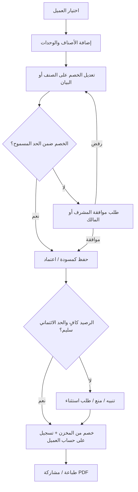
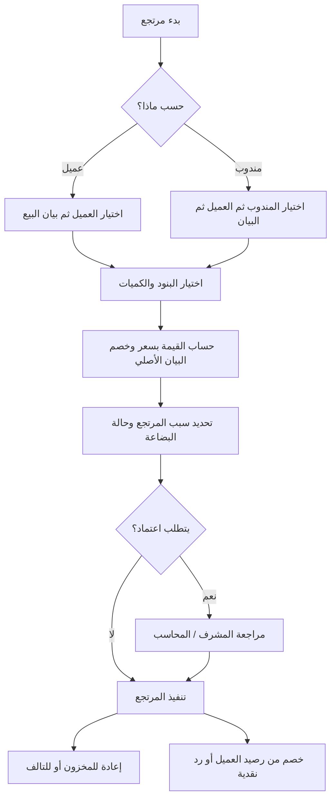
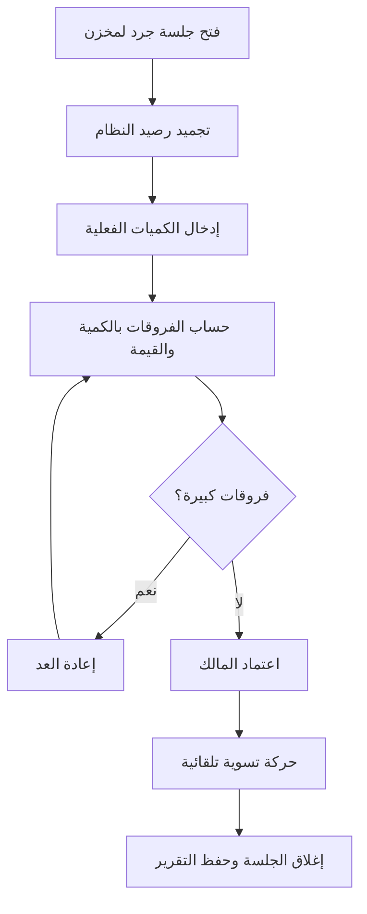
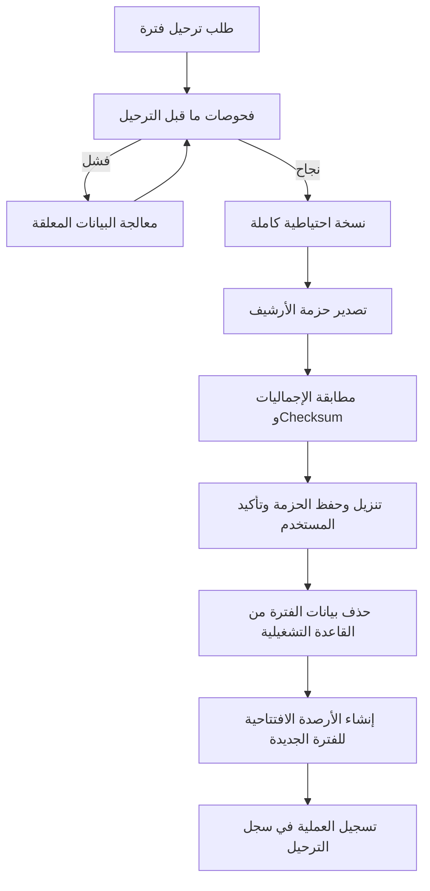
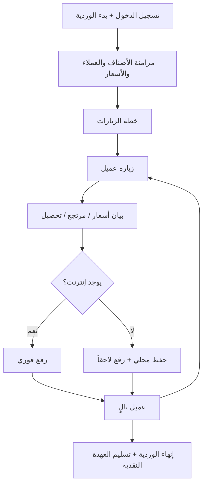

# مقترح تصميم برنامج "بيان" لمبيعات الحديد والبويات

> الإصدار: 1.0 (مقترح تصميمي) | التاريخ: 6 أكتوبر 2026
> إعداد: مقترح لـ MiB Technology

---

## 1. الاسم المقترح للتطبيق

**الاسم الأساسي: «بيان»**

- سبب الاختيار: المخرج الرسمي للبرنامج اسمه "بيان أسعار" وليس فاتورة، فالاسم يعبر عن المنتج نفسه.
- قصير، سهل النطق، ومألوف في السوق المصري (بيان أسعار / بيان حساب).
- مناسب كأيقونة وشعار (حرف "ب" مع شكل شيكارة/جركن دهان).
- النطق الإنجليزي: `Bayan`.

**بدائل مقترحة:**

| الاسم           | الفكرة                                                       |
| --------------- | ------------------------------------------------------------ |
| **المعلّم**     | لقب مألوف جداً في سوق مواد البناء المصري                     |
| **شيكارة**      | وحدة بيع معروفة ومميزة، لكنها قد تحصر النشاط في مواد الأسمنت |
| **حديد وألوان** | وصفي مباشر، لكنه ضعيف كعلامة تجارية                          |
| **ميزان**       | يعبر عن الدقة والبيع بالوزن                                  |

---

## 2. نظرة عامة

### 2.1 الهدف

نظام متكامل لشركة تبيع الحديد والبويات (جملة وقطاعي) يغطي: الأصناف والوحدات المتعددة، بيانات الأسعار، المشتريات، المخازن والجرد، المرتجعات، العملاء والمناديب، التتبع الجغرافي، والترحيل الدوري للبيانات.

### 2.2 مكونات النظام

1. **لوحة التحكم (Web Admin):** للإدارة والمحاسبين وأمناء المخازن.
2. **تطبيق المناديب (Mobile App - Android أولاً):** يعمل أونلاين وأوفلاين.
3. **الخادم (Backend API):** قاعدة البيانات والمنطق والتزامن.
4. **خدمة الأرشفة والتصدير:** ترحيل البيانات لملفات خارجية.

### 2.3 خصوصية النشاط

| الصنف       | الخصوصية                                                                                                          |
| ----------- | ----------------------------------------------------------------------------------------------------------------- |
| **الحديد**  | بيع بالطن والكيلو والعدد (سيخ/قطعة)، اختلاف الأقطار والأطوال، تذبذب شديد في السعر اليومي، أوزان نظرية مقابل فعلية |
| **البويات** | بيع بالجركن والعبوة والكرتونة، ألوان وأحجام، ماركات متعددة، احتمال تشغيلات (Batch) وتواريخ صلاحية                 |

---

## 3. المصطلحات والقرارات الأساسية

| القرار         | التطبيق                                                                                                                                              |
| -------------- | ---------------------------------------------------------------------------------------------------------------------------------------------------- |
| تسمية الفاتورة | في كل الشاشات والطباعة والتصدير تظهر **"بيان أسعار"**، وبيان المشتريات يسمى **"بيان توريد"**، والمرتجع **"بيان مرتجع"**                              |
| العملة         | جنيه مصري كافتراضي، مع إمكانية إضافة عملة أخرى مستقبلاً                                                                                              |
| اللغة          | واجهة عربية RTL كاملة، مع دعم الإنجليزية للتقارير عند الحاجة                                                                                         |
| أرقام البيانات | تسلسل تلقائي لا يتكرر، مع بادئة لكل نوع (BP- للأسعار، RT- للمرتجع، PR- للتوريد) وبادئة خاصة بكل مندوب لتفادي التعارض أوفلاين (مثال: `BP-M03-000127`) |
| اللغة الافتراضية | **العربية RTL افتراضياً** في كل شاشات النظام والطباعة والتصدير، مع إمكانية الإنجليزية للتقارير لاحقاً |
| أوراق الطباعة    | **A4 / A5 / إيصال 80 مم** + تصدير PDF عربي، مع تبديل المقاس من شاشة الطباعة |
| نموذج التشغيل    | **SaaS متعدد الشركات:** كل شركة مستأجر منفصل بحالة تفعيل، وميزات يمكن تفعيلها/تعطيلها عاماً أو لمستخدم بعينه |

---

## 4. الأدوار والصلاحيات

### 4.1 الأدوار

| الدور                     | المسؤوليات الأساسية                                                     |
| ------------------------- | ----------------------------------------------------------------------- |
| **مدير النظام (Admin)**   | كل الصلاحيات، إدارة المستخدمين، الإعدادات، الترحيل                      |
| **المدير العام / المالك** | الاطلاع على كل التقارير، الموافقة على الخصومات الكبيرة، اعتماد الجرد    |
| **المحاسب**               | بيانات الأسعار، المشتريات، المرتجعات، حسابات العملاء والموردين، التحصيل |
| **أمين المخزن**           | الاستلام والصرف، التحويلات بين المخازن، الجرد                           |
| **موظف المبيعات (مكتب)**  | إصدار بيانات الأسعار من المكتب أو المعرض                                |
| **مندوب المبيعات**        | تطبيق الموبايل فقط: عملاؤه، بيانات أسعاره، تحصيل، مرتجع                 |
| **مشرف المناديب**         | متابعة المناديب على الخريطة، مراجعة بياناتهم، اعتماد الخصومات           |

### 4.2 مصفوفة الصلاحيات (ملخص)

| الوظيفة                 | مدير |  مالك  |  محاسب  | أمين مخزن  | مبيعات مكتب |        مندوب         |     مشرف     |
| ----------------------- | :--: | :----: | :-----: | :--------: | :---------: | :------------------: | :----------: |
| إنشاء بيان أسعار        |  ✔   |   ✔    |    ✔    |     ✘      |      ✔      |      ✔ (عملاؤه)      |      ✔       |
| تعديل بيان بعد الاعتماد |  ✔   |   ✔    |    ✔    |     ✘      |      ✘      | ✔ (قبل الاعتماد فقط) |      ✔       |
| خصم على الصنف           |  ✔   |   ✔    | حد أقصى |     ✘      |   حد أقصى   |       حد أقصى        | حد أقصى أعلى |
| خصم على البيان ككل      |  ✔   |   ✔    | حد أقصى |     ✘      |   حد أقصى   |       حد أقصى        | حد أقصى أعلى |
| رؤية سعر التكلفة        |  ✔   |   ✔    |    ✔    |     ✘      |      ✘      |          ✘           |      ✘       |
| المرتجعات               |  ✔   |   ✔    |    ✔    | استلام فقط |      ✔      |      ✔ (عملاؤه)      |    اعتماد    |
| الجرد                   |  ✔   | اعتماد |   عرض   |   تنفيذ    |      ✘      |          ✘           |      ✘       |
| الترحيل والأرشفة        |  ✔   |   ✔    |    ✘    |     ✘      |      ✘      |          ✘           |      ✘       |
| تتبع المناديب           |  ✔   |   ✔    |    ✘    |     ✘      |      ✘      |          ✘           |      ✔       |
| إدارة الأسعار           |  ✔   |   ✔    |    ✔    |     ✘      |      ✘      |          ✘           |      ✘       |

> **حدود الخصم:** تُضبط لكل دور ولكل مستخدم (نسبة قصوى على الصنف ونسبة قصوى على البيان). أي تجاوز يتحول إلى **طلب موافقة** يصل للمشرف أو المالك.

---

## 5. الوظائف الأساسية (الوحدات)

### 5.1 إدارة الأصناف

**بيانات الصنف:**

- الكود، الباركود (اختياري)، الاسم عربي/إنجليزي، التصنيف (حديد / بويات / أدوات / إكسسوارات)، الماركة، المنشأ.
- حالة الصنف (نشط / موقوف).
- حد أدنى للمخزون (نقطة إعادة الطلب).
- خصائص حسب التصنيف:
  - **حديد:** القطر، الطول، الدرجة (مثل 36 / 52)، الوزن النظري للقطعة.
  - **بويات:** اللون / كود اللون، السعة، النوع (بلاستيك / زيت / ...)، تتبع التشغيلة وتاريخ الصلاحية (اختياري).
- صور للصنف.
- **الأصناف المتغيرة (Variants):** صنف أساسي مع تنويعات (مثل دهان واحد بعدة ألوان وعبوات) دون تكرار البيانات.

### 5.2 الوحدات المتعددة للصنف

لكل صنف **وحدة أساسية** (أصغر وحدة تخزين) ووحدات بديلة بمعامل تحويل.

| الصنف               | الوحدة الأساسية | وحدات أخرى                                    |
| ------------------- | --------------- | --------------------------------------------- |
| حديد تسليح 12 مم    | كجم             | سيخ = 10.656 كجم، طن = 1000 كجم، حزمة = N سيخ |
| دهان بلاستيك 18 لتر | عبوة            | كرتونة = 1 / 4 عبوات (حسب الصنف)              |
| أسمنت / جبس / معجون | كجم             | شيكارة = 50 كجم                               |
| مسامير              | كجم             | علبة / كرتونة                                 |

**قواعد الوحدات:**

- جدول `item_units` يحدد لكل وحدة: معامل التحويل للوحدة الأساسية، سعر بيع مستقل (اختياري)، باركود مستقل (اختياري)، هل هي وحدة بيع / شراء / كلاهما.
- **نوع القياس:** عددي (يقبل أعداداً صحيحة فقط) أو وزني (يقبل كسوراً بدقة 3 خانات).
- **الميزان:** إمكانية إدخال الوزن يدوياً، أو ربط ميزان إلكتروني مستقبلاً (مرحلة لاحقة).
- المخزون يُخزن دائماً بالوحدة الأساسية ويُعرض بأي وحدة، مع عرض مركب مثل "3 كرتونة + 2 عبوة".
- مسموح البيع بوحدة مختلفة عن الشراء مع تحويل تلقائي.
- **حالة خاصة للحديد:** إمكانية بيع نفس الصنف بالطن أو بالكيلو أو بالسيخ مع إظهار الفرق بين الوزن النظري والفعلي (وزن الشاحنة) في حقل ملاحظة الوزن الفعلي.

### 5.3 قوائم الأسعار

- **سعر الشراء (التكلفة)** وآخر سعر شراء وتاريخه، ومتوسط التكلفة المرجح.
- عدة قوائم بيع: **قطاعي، جملة، جملة الجملة، مشاريع/مقاولين**، وكل عميل مرتبط بقائمة افتراضية.
- **تسعير يومي للحديد:** شاشة سريعة لتحديث أسعار كل أصناف الحديد دفعة واحدة (بنسبة أو بقيمة أو إدخال جماعي)، مع **سجل كامل لتغيرات الأسعار** (من غيّر، متى، من كم إلى كم).
- تاريخ سريان للسعر (سعر مجدول).
- تنبيه عند البيع بأقل من التكلفة أو أقل من حد أدنى للسعر (صلاحية استثناء بموافقة).

### 5.4 العملاء

- البيانات: الاسم، النشاط، العنوان، الموقع على الخريطة، أرقام الهاتف، الرقم الضريبي (إن وجد)، المندوب المسؤول، قائمة السعر الافتراضية.
- **حد ائتماني** ومدة سداد، وتنبيه أو منع عند تجاوزه (بحسب الإعداد).
- كشف حساب العميل (بيانات، مرتجعات، تحصيلات، رصيد افتتاحي).
- تقادم الديون (0-30 / 31-60 / 61-90 / +90 يوم).
- تصنيف العملاء (A/B/C) وتقييم السداد.
- تعيين عميل لمندوب أو أكثر، مع تاريخ تحويل العميل بين المناديب.

### 5.5 الموردين والمشتريات

- بيان توريد (شراء) بنفس منظومة الوحدات والخصومات.
- أوامر شراء ← استلام ← بيان توريد (اختياري التسلسل الكامل).
- كشف حساب المورد، السداد، مرتجع مشتريات.
- تحديث آخر سعر شراء تلقائياً عند اعتماد بيان التوريد (مع خيار تعطيل).
- مصروفات نقل ومصاريف إضافية تُوزع على تكلفة الأصناف (Landed Cost) — اختياري.

### 5.6 بيان الأسعار (الفاتورة)

**الحالات:** مسودة ← معتمد ← (مرحّل للأرشيف). وحالة جانبية: ملغي.

**محتوى البيان:**

- الرأس: الرقم، التاريخ، العميل، المندوب/المستخدم، المخزن، قائمة السعر، طريقة الدفع (نقدي/آجل/مختلط)، ملاحظات، موقع الإصدار GPS (للمندوب).
- البنود: الصنف، الوحدة، الكمية، السعر، **خصم الصنف (نسبة أو قيمة)**، الإجمالي.
- التذييل: الإجمالي الفرعي، **خصم البيان (نسبة أو قيمة)**، مصاريف نقل/تحميل (اختياري)، ضريبة (اختياري حسب الإعداد)، الصافي، المدفوع، المتبقي.

**الخصومات (متطلب أساسي):**

| الحالة                     | السلوك                                                                   |
| -------------------------- | ------------------------------------------------------------------------ |
| خصم على صنف بنسبة %        | يُحسب على إجمالي بند الصنف                                               |
| خصم على صنف بقيمة ثابتة    | يُخصم من إجمالي بند الصنف                                                |
| خصم على البيان بنسبة %     | يُحسب على صافي البنود بعد خصوماتها                                       |
| خصم على البيان بقيمة ثابتة | يُخصم من الصافي، ويُوزع نسبياً على البنود لأغراض حساب الربحية والمرتجعات |

- الترتيب: خصم الصنف أولاً ثم خصم البيان.
- يحوّل أحدهما للآخر آلياً أثناء الإدخال (إدخال النسبة يُظهر القيمة والعكس).
- التحقق من حد الخصم المسموح لكل مستخدم وإرسال طلب موافقة عند التجاوز.
- يحفظ سجل بكل تعديل على الخصم (Audit).

**قواعد أخرى:**

- منع البيع بكمية أكبر من المتاح (أو السماح بالرصيد السالب حسب الإعداد).
- تعديل البيان بعد الاعتماد يتم بإنشاء **نسخة معدلة** مع حفظ سجل التعديلات (لا حذف مباشر).
- الإلغاء بسبب إلزامي وصلاحية خاصة.
- الطباعة: A4 وإيصال حراري 80 مم، ومشاركة PDF عبر واتساب من التطبيق.
- يظهر على المطبوع عنوان **"بيان أسعار"** مع شعار الشركة وبياناتها ورصيد العميل قبل وبعد.

### 5.7 المخازن

- مخازن متعددة (رئيسي، حديد، بويات، سيارات المناديب، معرض...) ولكل مخزن مسؤول.
- حركات المخزون: استلام، صرف، تحويل بين مخازن، تسوية جرد، مرتجع، رصيد افتتاحي.
- **مخزن للمندوب (عهدة):** تحويل بضاعة لمخزن مندوب ثم البيع منه (اختياري حسب طريقة عمل الشركة).
- رصيد لحظي لكل صنف في كل مخزن، وحجز مؤقت للكميات في البيانات المسودة (اختياري).
- بطاقة الصنف (Item Ledger) بكل الحركات.

### 5.8 الجرد وتقييم المخازن

**دورة الجرد (لكل مخزن على حدة):**

1. **فتح جلسة جرد** لمخزن محدد (كلي أو جزئي: تصنيف / ماركة / مجموعة أصناف).
2. **تجميد رصيد النظام** لحظة الفتح (Snapshot) مع منع/تحذير للحركات على المخزن أثناء الجرد حسب الإعداد.
3. **إدخال الكميات الفعلية** من الويب أو الموبايل (بالمسح أو يدوياً) ويدعم أكثر من عداد.
4. **المقارنة:** عرض الفروقات بالكمية والقيمة (عجز / زيادة).
5. **مراجعة وإعادة عد** للأصناف ذات الفروقات الكبيرة.
6. **اعتماد المالك** ← إنشاء **حركة تسوية** تلقائية ← إغلاق الجلسة وحفظ تقرير الجرد.

**تقييم المخزون:**

- **القيمة = الكمية × آخر سعر شراء للصنف** (الطريقة المطلوبة).
- لكل مخزن على حدة، وإجمالي كل المخازن.
- تقرير بخيارات عرض: بالوحدة الأساسية / بالوحدات الكبرى.
- خيارات إضافية قابلة للتفعيل مستقبلاً: متوسط مرجح، أو سعر البيع.
- ملاحظة: إن لم يوجد آخر سعر شراء للصنف يُعرض تنبيه "بدون سعر" ويستبعد من الإجمالي مع إظهار عددها.

### 5.9 المرتجعات

**أنواع المرتجع:**

1. **مرتجع حسب العميل:** يختار المستخدم العميل ← تظهر بيانات أسعاره السابقة ← يحدد البند.
2. **مرتجع حسب المندوب:** يختار المندوب ← يظهر ما باعه ← يحدد العميل والبيان والبند.

**القاعدة الجوهرية:** المرتجع **مرتبط ببيان البيع الأصلي** ويُقيّم بقيمته فيه:

- سعر الوحدة بعد خصم الصنف **وبعد نصيبه من خصم البيان** كما في البيان الأصلي (لا بسعر اليوم).
- الكمية المرتجعة لا تتجاوز (الكمية المباعة − ما سبق إرجاعه).
- يمكن إرجاع جزء من الكمية، وبوحدة مختلفة مع التحويل.
- لا يمكن إنشاء مرتجع لصنف لم يُبع للعميل (إلا بصلاحية خاصة "مرتجع بدون بيان" مع موافقة).
- سبب المرتجع إلزامي (عيب / خطأ طلب / تلف / أخرى).
- حالة البضاعة المرتجعة: **صالحة** (تعود للمخزون) أو **تالفة** (مخزن التالف أو تسوية).
- أثر المرتجع المالي: خصم من رصيد العميل أو رد نقدية أو رصيد دائن.
- المرتجعات من تطبيق المندوب تحتاج **اعتماد** المشرف/المحاسب قبل التأثير النهائي (اختياري بالإعداد).

### 5.10 التحصيل والخزينة

- سندات قبض (نقدي، تحويل، شيك، فودافون كاش/إنستاباي) وسندات صرف.
- ربط التحصيل ببيانات محددة أو على الحساب.
- متابعة الشيكات (حافظة شيكات: تحت التحصيل / محصل / مرتد).
- تحصيل المندوب وتسليمه للخزينة بمحضر **تسليم عهدة** مع مطابقة.
- يومية الخزينة والإقفال اليومي.

### 5.11 ترحيل الفواتير والأرشفة (متطلب أساسي)

**الفكرة:** تخفيف قاعدة البيانات التشغيلية بترحيل البيانات المنتهية لملفات خارجية، مع بدء فترة جديدة نظيفة.

**خطوات الترحيل:**

1. المستخدم المخوّل يفتح **"إغلاق فترة / ترحيل"** ويحدد المدى (من تاريخ إلى تاريخ، أو حتى تاريخ معين).
2. **فحوصات ما قبل الترحيل:**
   - لا توجد بيانات مسودة في الفترة.
   - لا توجد بيانات غير متزامنة من أجهزة المناديب.
   - لا توجد مرتجعات معلقة على بيانات الفترة.
   - **نسخة احتياطية كاملة** تؤخذ تلقائياً قبل أي شيء.
3. **التصدير:** إنشاء حزمة أرشيف تحتوي:
   - ملف **Excel** لكل نوع (بيانات الأسعار، البنود، المرتجعات، التوريد، السندات، حركات المخزون).
   - ملف **PDF** مجمع لبيانات الأسعار (اختياري).
   - ملف **JSON/SQLite** كامل قابل لإعادة الاستيراد والعرض.
   - ملف `manifest` يحوي العدد والإجماليات و**Checksum SHA-256** لكل ملف.
4. **التحقق:** مطابقة الإجماليات والأعداد بين الحزمة وقاعدة البيانات.
5. **الحفظ:** تنزيل الحزمة للمستخدم + حفظها على مساحة النظام/تخزين سحابي مع **تأكيد المستخدم أنه حفظها**.
6. **الحذف من قاعدة البيانات التشغيلية** بعد تأكيد صريح (كتابة كلمة تأكيد).
7. **تدوير الأرصدة:** إنشاء **أرصدة افتتاحية** للفترة الجديدة:
   - رصيد كل عميل ومورد.
   - رصيد كل صنف في كل مخزن.
   - رصيد الخزائن.
8. بدء ترقيم جديد للبيانات (اختياري) مع الاحتفاظ بالبادئة وسنة/فترة (مثال: `BP-2027-000001`).

**إجراءات إضافية:**

- **عارض الأرشيف (Archive Viewer):** فتح حزمة قديمة للاطلاع والبحث والطباعة دون إدخالها لقاعدة البيانات.
- كشف حساب العميل يستطيع عرض رصيد افتتاحي "مرحّل" مع رابط الأرشيف.
- إمكانية **استعادة** حزمة (للمدير فقط وبحالات محدودة).
- جدولة تذكير دوري: "مضى X شهر منذ آخر ترحيل".
- سجل بكل عمليات الترحيل (من نفذ، متى، المدى، الأعداد، مكان الحفظ).
- **لا ترحيل** لبيانات تؤثر على حد ائتماني قائم أو مطالبات مفتوحة إلا بعد ترحيل أرصدتها كأرصدة افتتاحية.

### 5.12 تطبيق المناديب

**الوظائف:**

- تسجيل دخول بحساب + رقم جهاز مسجل (ربط جهاز واحد، والتغيير بموافقة).
- **عملائي:** قائمة عملاء المندوب مع الرصيد والموقع وآخر بيان.
- إنشاء **بيان أسعار** جديد، تعديل بيان (قبل الاعتماد أو حسب الصلاحية)، حفظ مسودة.
- الاطلاع على الأصناف والأسعار والأرصدة (حسب مخزنه/المخزن الرئيسي).
- تعديل **خصم الصنف** و**خصم البيان** ضمن الحد المسموح.
- **مرتجع** لعملائه حسب بيان البيع.
- **تحصيل** وإصدار سند قبض.
- طباعة حرارية بلوتوث ومشاركة PDF.
- **خطة الزيارات:** جدول يومي للعملاء وتسجيل الزيارة (تمت / لم تتم + سبب).
- مؤشرات المندوب: مبيعاته، التارجت، التحصيل.
- **وضع Offline كامل:** تنزيل الأصناف والعملاء والأسعار محلياً، وإصدار بيانات بدون إنترنت.

**التزامن (Sync):**

- كل بيان يحمل `client_uuid` فريداً لمنع التكرار.
- رفع تلقائي عند توفر الاتصال بمحاولات متكررة (Retry with backoff).
- **حل التعارضات:** إذا تغير سعر أو رصيد أثناء الأوفلاين، يظهر للمراجع تنبيه "تغير السعر/الرصيد" وتُراجع البيانات في حالة **"بانتظار المراجعة"**.
- ترقيم البيانات بنطاق خاص لكل مندوب.
- مؤشر واضح بحالة كل بيان (محلي / مرفوع / معتمد / مرفوض).

### 5.13 تتبع المناديب جغرافياً

- **يعمل فقط عند تشغيل التطبيق وتسجيل بدء يوم العمل** ("بدء الوردية" / "إنهاء الوردية").
- إرسال الموقع كل 30-120 ثانية (قابل للضبط) مع توفير البطارية (تخفيف التردد عند السكون).
- خريطة مباشرة للمشرف/الإدارة تعرض آخر موقع لكل مندوب (OpenStreetMap أو Google Maps).
- **مسار اليوم (Route Replay):** إعادة عرض خط سير المندوب بالتفصيل والتوقفات.
- ربط الموقع بكل بيان وكل زيارة وتحصيل (مطابقة قرب المندوب من موقع العميل بنطاق مثل 150 م، وتنبيه عند المخالفة).
- تقارير: المسافة المقطوعة، زمن التوقف عند العملاء، العملاء الذين لم تتم زيارتهم.
- **اعتبارات الخصوصية والالتزام (مهم):**
  - إعلام المندوب بوضوح بالتتبع وأخذ **موافقة موقعة** في العقد/سياسة الشركة.
  - لا تتبع خارج ساعات الوردية.
  - مؤشر ظاهر في التطبيق أثناء التتبع (إشعار دائم لأندرويد).
  - الاحتفاظ بسجلات الموقع مدة محددة (مثلاً 90 يوم) ثم حذفها تلقائياً.
  - مراعاة نظام حماية البيانات الشخصية (القانون المصري 151 لسنة 2020).

### 5.14 التقارير

| المجال        | التقارير                                                                                            |
| ------------- | --------------------------------------------------------------------------------------------------- |
| المبيعات      | يومي/شهري، حسب الصنف/التصنيف/الماركة/العميل/المندوب، أعلى الأصناف مبيعاً، أرباح (لمن لديه الصلاحية) |
| الخصومات      | إجمالي الخصومات حسب المستخدم/المندوب/الصنف، الخصومات المتجاوزة والمعتمدة                            |
| المرتجعات     | حسب العميل/المندوب/السبب/الصنف ونسبة المرتجع إلى المبيعات                                           |
| العملاء       | كشوف الحساب، تقادم الديون، العملاء المتوقفون                                                        |
| المخزون       | أرصدة لحظية، بطاقة صنف، أصناف تحت الحد الأدنى، أصناف راكدة                                          |
| تقييم المخازن | القيمة بآخر سعر شراء لكل مخزن وإجمالي                                                               |
| الجرد         | تقرير الفروقات وتسويات الجرد                                                                        |
| المناديب      | الأداء، التارجت، التحصيل، الزيارات، المسافات                                                        |
| المالية       | الخزينة، التحصيلات، الشيكات، مديونيات الموردين                                                      |
| التدقيق       | سجل العمليات (من فعل ماذا ومتى)                                                                     |

- التصدير: Excel / PDF / CSV، وطباعة.
- لوحة مؤشرات (Dashboard) للمالك بأرقام اللحظة.

### 5.15 الإشعارات والتنبيهات

- طلبات موافقة الخصم (للمشرف/المالك) لحظياً.
- أصناف تحت الحد الأدنى.
- تجاوز الحد الائتماني.
- تذكير بالترحيل الدوري وبالنسخ الاحتياطي.
- حالة المزامنة وفشل الرفع (للمندوب).
- المرتجعات بانتظار الاعتماد.

### 5.16 وظائف مقترحة إضافية

- **باركود/QR** للأصناف والعملاء.
- **عروض وأسعار خاصة** لعميل أو مجموعة عملاء لفترة.
- **تارجت المناديب** وعمولات تُحسب آلياً (نسبة من المبيعات المحصلة).
- **عرض سعر (Quotation)** يتحول إلى بيان أسعار بضغطة.
- **كشف حساب يُرسل عبر واتساب** للعميل.
- **حاسبة كميات الدهانات** (مساحة ← عدد العبوات) كأداة مساعدة للمندوب.
- **حاسبة أوزان الحديد** (قطر وطول وعدد ← وزن).
- **تعدد الفروع** مستقبلاً.
- **نسخ احتياطي تلقائي** يومي مشفر.

---

## 6. خرائط العمل (Workflows)

### 6.1 دورة بيان الأسعار



### 6.2 دورة المرتجع



### 6.3 دورة الجرد



### 6.4 دورة الترحيل الدوري



### 6.5 دورة يوم المندوب



---

## 7. البنية التقنية المقترحة

### 7.1 الحزمة التقنية

| الطبقة               | المقترح                                            | السبب                                     |
| -------------------- | -------------------------------------------------- | ----------------------------------------- |
| قاعدة البيانات       | **PostgreSQL**                                     | قوية، تدعم JSON وفهارس جغرافية (PostGIS)  |
| الخادم               | **Node.js (NestJS)** أو **Laravel** أو **Django**  | يعتمد على خبرة الفريق، وكلها مناسبة       |
| لوحة الويب           | **React / Next.js** مع RTL                         | واجهة سريعة وسهلة الصيانة                 |
| تطبيق الموبايل       | **Flutter** (أندرويد أولاً ثم iOS)                 | كود واحد، دعم Offline وطباعة بلوتوث ممتاز |
| تخزين محلي بالموبايل | **SQLite (Drift)**                                 | للعمل أوفلاين                             |
| الخرائط              | **OpenStreetMap + Leaflet** (مجاني) أو Google Maps | حسب الميزانية                             |
| الإشعارات            | **Firebase Cloud Messaging**                       | للموافقات والتنبيهات                      |
| التقارير/التصدير     | ExcelJS / WeasyPrint أو مكتبة PDF                  | تصدير Excel وPDF عربي سليم                |
| الاستضافة            | سيرفر محلي (On-Premise) أو VPS                     | قرار حسب رغبة العميل في الخصوصية          |
| النسخ الاحتياطي      | pg_dump مجدول + نسخة خارجية مشفرة                  | يومي                                      |

### 7.2 المعمارية

```
 [Flutter Mobile] ─┐
                   ├─ HTTPS / REST API (JWT) ─► [Backend] ─► [PostgreSQL + PostGIS]
 [Web Admin]  ─────┘                              │
                                                  ├─► [Queue: ترحيل / تصدير / تقارير ثقيلة]
                                                  ├─► [File Storage: أرشيف + صور]
                                                  └─► [FCM: إشعارات]
```

### 7.3 نموذج البيانات (الجداول الأساسية)

| الجدول                              | أهم الحقول                                                                                                                                                                                                 |
| ----------------------------------- | ---------------------------------------------------------------------------------------------------------------------------------------------------------------------------------------------------------- |
| `users`                             | id, name, phone, role_id, max_item_discount_pct, max_invoice_discount_pct, device_id, active                                                                                                               |
| `roles`, `permissions`              | صلاحيات دقيقة لكل وظيفة                                                                                                                                                                                    |
| `items`                             | id, code, name_ar, name_en, category_id, brand_id, base_unit_id, track_batch, min_stock, last_purchase_cost, active                                                                                        |
| `item_attributes`                   | item_id, key, value (قطر، طول، لون، سعة...)                                                                                                                                                                |
| `units`                             | id, name (كجم، طن، سيخ، شيكارة، عبوة، كرتونة...)                                                                                                                                                           |
| `item_units`                        | item_id, unit_id, factor_to_base, barcode, is_sale, is_purchase, allow_decimal                                                                                                                             |
| `price_lists`                       | id, name (قطاعي، جملة...)                                                                                                                                                                                  |
| `item_prices`                       | item_id, unit_id, price_list_id, price, valid_from                                                                                                                                                         |
| `price_history`                     | item_id, unit_id, old_price, new_price, changed_by, changed_at                                                                                                                                             |
| `customers`                         | id, name, phone, address, lat, lng, price_list_id, credit_limit, credit_days, rep_id, opening_balance                                                                                                      |
| `suppliers`                         | id, name, phone, opening_balance                                                                                                                                                                           |
| `warehouses`                        | id, name, type (رئيسي/مندوب/تالف), keeper_id                                                                                                                                                               |
| `stock_balances`                    | warehouse_id, item_id, qty_base (+ batch_id اختياري)                                                                                                                                                       |
| `stock_movements`                   | id, type, warehouse_id, item_id, qty_base, ref_type, ref_id, cost, created_at                                                                                                                              |
| `price_statements` (بيانات الأسعار) | id, number, client_uuid, customer_id, rep_id, warehouse_id, date, status, subtotal, discount_type, discount_value, discount_amount, shipping, tax, net, paid, lat, lng, created_by, approved_by, period_id |
| `price_statement_lines`             | id, statement_id, item_id, unit_id, qty, factor, qty_base, unit_price, line_discount_type, line_discount_value, line_discount_amount, allocated_header_discount, net_line, cost_snapshot                   |
| `statement_revisions`               | statement_id, revision_no, snapshot_json, changed_by, reason                                                                                                                                               |
| `return_statements`                 | id, number, customer_id, rep_id, return_mode (by_customer/by_rep), date, status, total, reason_id                                                                                                          |
| `return_lines`                      | id, return_id, source_line_id, item_id, unit_id, qty, unit_net_price, line_total, condition (good/damaged)                                                                                                 |
| `purchase_statements` + `_lines`    | نفس فكرة المبيعات للتوريد                                                                                                                                                                                  |
| `receipts` / `payments`             | سندات القبض والصرف، طريقة الدفع، ربط بالبيان                                                                                                                                                               |
| `cheques`                           | رقم، بنك، استحقاق، حالة                                                                                                                                                                                    |
| `stocktake_sessions`                | id, warehouse_id, status, opened_by, approved_by, opened_at, closed_at                                                                                                                                     |
| `stocktake_lines`                   | session_id, item_id, system_qty_base, counted_qty_base, diff_qty, last_cost, diff_value                                                                                                                    |
| `rep_locations`                     | id, rep_id, shift_id, lat, lng, accuracy, battery, captured_at                                                                                                                                             |
| `rep_shifts`                        | id, rep_id, started_at, ended_at, start_lat/lng, end_lat/lng                                                                                                                                               |
| `rep_visits`                        | id, rep_id, customer_id, status, reason, lat, lng, at                                                                                                                                                      |
| `approvals`                         | id, type (discount/return/below_cost), ref_id, requested_by, status, decided_by, note                                                                                                                      |
| `periods`                           | id, from_date, to_date, status, archive_file, checksum, closed_by, closed_at                                                                                                                               |
| `audit_log`                         | id, user_id, action, entity, entity_id, before_json, after_json, at                                                                                                                                        |

**المحاسبة:** حركات العملاء والموردين والخزينة تُسجَّل في **دفتر حسابات فرعي (Ledger)** بقيود مدين/دائن، ليكون كشف الحساب والأرصدة الافتتاحية دقيقة. ويمكن لاحقاً ربطها بنظام محاسبة عام.

### 7.4 معادلات الحساب

```
قيمة_البند_قبل_الخصم  = الكمية × سعر_الوحدة
خصم_البند             = (نسبة؟ قيمة_البند × %  : قيمة ثابتة)
صافي_البند_1          = قيمة_البند_قبل_الخصم − خصم_البند
مجموع_البنود          = Σ صافي_البند_1
خصم_البيان            = (نسبة؟ مجموع_البنود × % : قيمة ثابتة)
نصيب_البند_من_خصم_البيان = خصم_البيان × (صافي_البند_1 / مجموع_البنود)
صافي_البند_النهائي    = صافي_البند_1 − نصيب_البند_من_خصم_البيان
الصافي                = مجموع_البنود − خصم_البيان + نقل + ضريبة

سعر_وحدة_المرتجع      = صافي_البند_النهائي / كمية_البند_الأصلية (لكل وحدة بيع)
قيمة_المرتجع          = كمية_المرتجع × سعر_وحدة_المرتجع

كمية_الأساس           = الكمية × معامل_التحويل
قيمة_المخزن           = Σ (رصيد_الصنف_بالأساس × آخر_سعر_شراء_للوحدة_الأساسية)
```

> تُقرّب الأرقام المالية إلى خانتين عشريتين، ويُعالج فرق التقريب في آخر بند.

---

## 8. تصميم الشاشات الرئيسية

### 8.1 لوحة الويب

- لوحة المؤشرات، بيانات الأسعار، الأصناف، العملاء، الموردين، المخازن، الجرد، المرتجعات، التحصيل، المناديب (الخريطة)، التقارير، الأرشفة والترحيل، المستخدمون والصلاحيات، الإعدادات.

### 8.2 تطبيق المندوب

1. الرئيسية (مؤشرات اليوم + بدء/إنهاء الوردية).
2. عملائي (بحث + فلتر + قرب المسافة).
3. بيان أسعار جديد (اختيار العميل ← بحث/مسح صنف ← الوحدة والكمية ← الخصم ← الدفع).
4. بياناتي (مسودات / مرفوعة / معتمدة).
5. مرتجع جديد.
6. تحصيل.
7. الأصناف والأسعار والأرصدة.
8. المزامنة والإعدادات.

**مبادئ التصميم:** أزرار كبيرة، خط عربي واضح، إدخال أرقام سريع، أقل عدد خطوات لإصدار البيان، ألوان مميزة لحالة المزامنة.

---

## 9. المتطلبات غير الوظيفية

| البند           | المستهدف                                                                                     |
| --------------- | -------------------------------------------------------------------------------------------- |
| الأداء          | فتح شاشة الأصناف أقل من ثانيتين على 50 ألف صنف                                               |
| التوافر         | العمل أوفلاين كاملاً للمندوب                                                                 |
| الأمان          | JWT + تشفير HTTPS، تشفير قاعدة البيانات الحساسة، قفل الجهاز بالبصمة/PIN، إلغاء الجهاز عن بعد |
| التدقيق         | سجل لكل عملية حساسة بالقيمة قبل وبعد                                                         |
| النسخ الاحتياطي | يومي تلقائي + قبل أي ترحيل + اختبار استعادة دوري                                             |
| قابلية التوسع   | دعم عدة مستخدمين متزامنين (50+) وعشرات المناديب                                              |
| التوطين         | RTL، تقويم ميلادي مع إمكانية الهجري، أرقام عربية/هندية اختيارية                              |
| التوافق         | أندرويد 8+، متصفحات حديثة                                                                    |

---

## 10. خطة التنفيذ المقترحة

| المرحلة                 | المحتوى                                                                             | المدة التقديرية |
| ----------------------- | ----------------------------------------------------------------------------------- | --------------- |
| **0. التحليل**          | اجتماعات مع الإدارة والمحاسب والمخزن والمناديب، تثبيت المتطلبات وجمع بيانات الأصناف | 2 أسبوع         |
| **1. النواة**           | المستخدمون والصلاحيات، الأصناف والوحدات والأسعار، العملاء والموردين، المخازن        | 5-6 أسابيع      |
| **2. البيانات**         | بيان الأسعار والخصومات، التوريد، المرتجعات، التحصيل                                 | 5-6 أسابيع      |
| **3. الجرد والتقارير**  | الجرد والتقييم، التقارير الأساسية، الطباعة                                          | 3-4 أسابيع      |
| **4. تطبيق المناديب**   | الأوفلاين والمزامنة، بيانات ومرتجعات وتحصيل، الطباعة بلوتوث                         | 6-8 أسابيع      |
| **5. التتبع الجغرافي**  | الوردية، الخريطة، مسار اليوم، الزيارات                                              | 3 أسابيع        |
| **6. الترحيل والأرشفة** | الحزم والتحقق والأرصدة الافتتاحية وعارض الأرشيف                                     | 3 أسابيع        |
| **7. التجربة والإطلاق** | ترحيل بيانات قديمة، تجربة موازية، تدريب، إطلاق تدريجي                               | 3-4 أسابيع      |

**الإجمالي التقريبي: 30-36 أسبوعاً** لفريق صغير (مطور باك إند + مطور موبايل + مطور ويب + محلل/مختبر)، ويمكن إطلاق **نسخة أولى (MVP)** بعد المرحلة 2-3 للمكتب، ثم المناديب لاحقاً.

---

## 11. المخاطر والتحديات

| الخطر                        | المعالجة                                                      |
| ---------------------------- | ------------------------------------------------------------- |
| تعارض البيانات أوفلاين       | ترقيم مستقل لكل مندوب، `client_uuid`، حالة "بانتظار المراجعة" |
| تذبذب أسعار الحديد           | شاشة تسعير سريعة، سجل أسعار، تحذير للبيانات المسودة القديمة   |
| ضياع بيانات عند الترحيل      | نسخة احتياطية + Checksum + تأكيد حفظ الحزمة قبل الحذف         |
| إساءة استخدام الخصومات       | حدود لكل مستخدم، موافقات، تقارير خصومات                       |
| رفض المناديب للتتبع          | سياسة واضحة، إشعار ظاهر، تتبع وقت الوردية فقط                 |
| بطء الموبايل مع بيانات كثيرة | مزامنة تفاضلية (Delta Sync)، فهارس محلية                      |
| اختلاف تقييم المخزون         | توثيق أن التقييم = آخر سعر شراء وإظهار الأصناف بلا سعر        |
| دقة وزن الحديد               | حقل وزن فعلي بجانب النظري، وتقرير فروق الأوزان                |

---

## 12. نظام متعدد الشركات (SaaS) وإدارة الميزات

### 12.1 النموذج

- النظام يُقدَّم **كخدمة لعدة شركات**؛ كل شركة مستأجر (Tenant) مستقلة بياناتياً.
- يوجد **مشرف عام (Global Admin)** للبيئة لا ينتمي لأي شركة، يدير سجل الشركات والميزات العامة.
- التسجيل الأولي (Onboarding) ينشئ شركة جديدة وتسجيل بياناتها، وقابل للتفعيل اليدوي/الآلي.

### 12.2 سجل الشركات

| الحقل        | الوصف                                            |
| ------------ | ------------------------------------------------ |
| الاسم        | الاسم التجاري للشركة                               |
| النطاق الفرعي/الكود | معرّف فريد للشركة (مثال: `acme`)                  |
| الحالة       | `ACTIVE` (فعّالة) / `DISABLED` (معطّلة)            |
| بيانات الاتصال | هاتف/بريد/مسؤول الشركة                            |

- **تعطيل شركة:** لا يمكن لمستخدميها تسجيل الدخول، وتُرفض كل طلبات الـ API الخاصة بها فوراً.
- **تفعيل شركة:** يعودون للعمل كما كان (لا تُحذف البيانات عند التعطيل).

### 12.3 الميزات (Feature Flags)

- قائمة ميزات مركزية (`system_features`) لكل ميزة: مفتاح، اسم عربي، حالة عامة (عام/مغلقة).
- **ثلاث مستويات للتطبيق**:
  1. **عام (Global):** من المشرف العام (مثال: تفعيل "تقارير التقييم" لكل الشركات).
  2. **على مستوى الشركة (اختياري لاحقاً):** تفعيل ميزة لشركة بعينها.
  3. **لكل مستخدم (Per-user):** تخصيص ميزة لمستخدم معين داخل الشركة (مثال: إتاحة التواقيع الذكية لمحاسب فقط).
- منطق التقييم: `مفعّلة()` = الحالة العامة (وإن وُجد استثناء للشركة/المستخدم يُطبَّق على أساسه).
- تُطبَّق الميزات على مستوى الواجهة (إخفاء الأزرار) وعلى مستوى الـ API (رفض العملية).

### 12.4 الصلاحيات

| الدور            | الصلاحيات                                              |
| ---------------- | ------------------------------------------------------ |
| المشرف العام     | قائمة الشركات، تفعيل/تعطيل، إدارة الميزات العامة، التقارير العامة |
| مسؤول الشركة     | إدارة مستخدمي شركته وفعّال/تعطيل ميزاتهم (ضمن الميزات العامة المفعّلة) |

---

## 13. نقاط مفتوحة تحتاج قرار من الإدارة

1. هل **آخر سعر** لتقييم المخزن هو **آخر سعر شراء** (المفترض هنا) أم آخر سعر بيع؟
2. هل يعمل المندوب على **مخزن عهدة خاص** أم يبيع من المخزن الرئيسي؟
3. هل الشركة **مسجلة ضريبياً** وتحتاج الفاتورة الإلكترونية (منظومة مصلحة الضرائب المصرية)؟ إن كان نعم فيُضاف تكامل منفصل، علماً بأن مسمى "بيان أسعار" داخلي ولا يغني عن الفاتورة الضريبية الرسمية.
4. هل يُسمح بالبيع **بالرصيد السالب**؟
5. هل يحتاج المرتجع **اعتماداً** دائماً أم فوق حد معين؟
6. مدة الترحيل المعتادة (شهري / ربع سنوي / سنوي)؟
7. هل تُدار **الشيكات** داخل النظام؟
8. هل يوجد **ميزان إلكتروني** يُربط بالنظام؟
9. حجم المناديب والمستخدمين وعدد الأصناف التقريبي.
10. الاستضافة: سيرفر محلي أم سحابي؟

---

## 14. ملحق: أمثلة سريعة

**مثال خصم:**

- بند: 10 طن حديد × 40,000 = 400,000. خصم الصنف 1% = 4,000 ← 396,000.
- بند: 20 عبوة دهان × 1,500 = 30,000. خصم 100 جنيه ثابت ← 29,900.
- المجموع: 425,900. خصم البيان 0.5% = 2,129.5 ← **الصافي 423,770.5**.
- المرتجع لاحقاً لـ 5 عبوات دهان يُحسب بصافي العبوة بعد نصيبها من خصم البيان وليس بسعر 1,500.

**مثال وحدات:**

- دهان 18 لتر: الوحدة الأساسية "عبوة"، الكرتونة = 1، وصنف دهان 3.5 لتر الكرتونة = 4 عبوات.
- الرصيد 22 عبوة يُعرض: "5 كرتونة + 2 عبوة".

---

_نهاية المستند_
